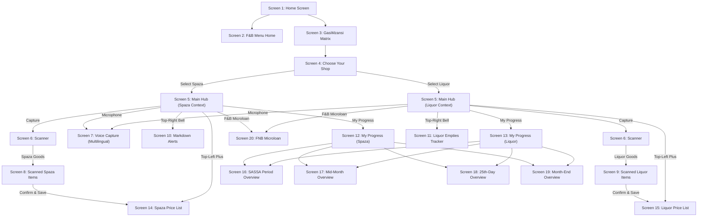
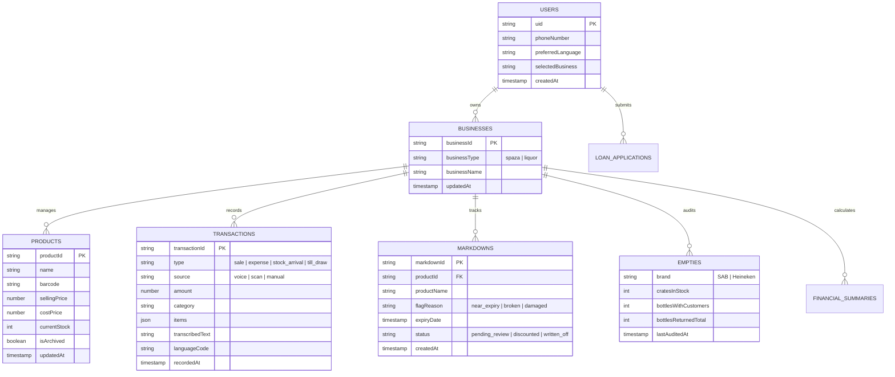

# Mzansi Matrix: Developer Handover Specification

**Document Version:** 1.0.0  
**Target Platform:** Flutter (Mobile & Web) + Firebase (Auth, Cloud Firestore, Realtime Database, Cloud Storage)  
**Reference Design System:** FNB Mzansi Matrix Design System  

---

## 1. Screen Inventory & Navigation Architecture

### 1.1 Complete 20-Screen Inventory

| Screen ID | Screen Name | Route / Identifier | Primary Trigger / Entry Point | Primary Destination / Next Transitions | Business Context |
|---|---|---|---|---|---|
| **Screen 1** | Home Screen | `/home` | App launch / Auth success | Navigates to F&B Menu or Main Hub | Global / Neutral |
| **Screen 2** | F&B Menu Home Screen | `/menu` | Bottom Nav "Menu" tab / Tile | Informational category views, settings, help | Global / Neutral |
| **Screen 3** | GasiMzansi Matrix | `/matrix` | Dashboard Quick Tile / Hub | Header Price List icon -> Screen 14/15; Shop Selector -> Screen 4 | Inherits Active Shop |
| **Screen 4** | Choose Your Shop | `/shop/select` | Top Shop Switcher / Sheet | Sets active shop (`spaza` vs `liquor`); updates global provider | Switches Context |
| **Screen 5** | Main Application Home | `/hub` | Post-selection Primary View | Capture (S6), Mic (S7), Progress (S12/13), Loan (S20), PriceList (S14/15), Notifs (S10/11) | Active Shop Scoped |
| **Screen 6** | Scanner | `/scanner` | Main Action: "Capture" / Tile | Barcode/Product -> S8 (Spaza) or S9 (Liquor); Invoices/Receipts -> Review | Active Shop Scoped |
| **Screen 7** | Voice Capture | `/voice` | Main Action: "Microphone" / FAB | Natural speech analysis -> Confirmation sheet -> Ledger event write | Active Shop Scoped |
| **Screen 8** | Scanned Spaza Items | `/scanner/spaza-review` | Scanner detects Spaza items | "Confirm & Save to Price List" -> writes to S14 catalogue | Spaza Shop Only |
| **Screen 9** | Scanned Liquor Items | `/scanner/liquor-review` | Scanner detects Liquor items | "Confirm & Save to All Price List" -> writes to S15 catalogue | Liquor Shop Only |
| **Screen 10** | Markdown Alerts | `/spaza/markdown` | Bell Icon (when Spaza active) | Item inspection -> Status update (Near expiry, broken, damaged) | Spaza Shop Only |
| **Screen 11** | Liquor Empties Tracker | `/liquor/empties` | Bell Icon (when Liquor active) | SAB/Heineken crate counts; customer bottle dispatch & return | Liquor Shop Only |
| **Screen 12** | My Progress (Spaza Shop) | `/spaza/progress` | Main Action: "My Progress" (Spaza) | Links to Price List (S14), Financial Overview (S16-19), Loan (S20) | Spaza Shop Only |
| **Screen 13** | My Progress (Liquor Shop) | `/liquor/progress` | Main Action: "My Progress" (Liquor) | Links to Price List (S15), Financial Overview (S16-19), Loan (S20) | Liquor Shop Only |
| **Screen 14** | Spaza Shop Price List | `/spaza/price-list` | Header "+" / Tile / Progress link | Add product dialog, edit price dialog, soft-delete item | Spaza Shop Only |
| **Screen 15** | Liquor Shop Price List | `/liquor/price-list` | Header "+" / Tile / Progress link | Add/Edit/Remove products (Castle, Amstel, Savanna, etc.) | Liquor Shop Only |
| **Screen 16** | SASSA Period Overview | `/finance/sassa` | Progress "SASSA" pill / Menu | View SASSA spend, family costs, savings, tailored speech advice | Active Shop Scoped |
| **Screen 17** | Mid-Month Overview | `/finance/mid-month` | Progress "Mid-month" pill | Spend control analysis, cash preservation advice speech bubble | Active Shop Scoped |
| **Screen 18** | 25th-Day Overview | `/finance/payday` | Progress "25th Day" pill | Payday restocking advice bubble based on real inventory & margin | Active Shop Scoped |
| **Screen 19** | Month-End Overview | `/finance/month-end` | Progress "Month-end" pill | Bulk wholesale replenishment comparison speech bubble | Active Shop Scoped |
| **Screen 20** | FNB Microloan | `/microloan` | Main Action: "F&B Microloan" / Card | 3-step stepper (Qualification, Approval, Access Funds), Top-Up | Active Shop Scoped |

---

## 1.2 Navigation Map (Flowchart)

---

## 2. Reusable Component Inventory

| Component Name | File Location | Purpose & Props | Visual Styling & State Constraints |
|---|---|---|---|
| `MzansiAppBar` | `lib/widgets/mzansi_app_bar.dart` | Header with back button, shop title, dynamic quick actions (PriceList "+", Notifications Bell). | Teal accent (`#00A8B5`), white background, badges for pending markdown/empties alerts. |
| `ShopSelectorBadge` | `lib/widgets/shop_selector_badge.dart` | Expandable shop pill on Hub displaying current shop (`My Spaza Shop` / `My Liquor Shop`). | Soft teal background (`#C9F3F5`), store icon, tap launches `ShopSelectionSheet`. |
| `AdviceSpeechBubble` | `lib/widgets/advice_speech_bubble.dart` | Displays personalized AI/rule-based guidance for financial periods (S16-S19). | Soft elliptical container (`#C9F3F5`), downward pointer arrow, multilingual support. |
| `FinancialMetricTile` | `lib/widgets/financial_metric_tile.dart` | Key-value row displaying Shop Cost, Family Cost, Savings, Take-Home Cash. | Icon prefix, categorized title, bold ZAR amount (`R 5,960.00`). |
| `PeriodFilterBar` | `lib/widgets/period_filter_bar.dart` | Filter chips for SASSA, Mid-Month, 25th Day, Month-End. | Outline teal border when active, switches advice bubble dynamically. |
| `VoiceMicButton` | `lib/widgets/voice_mic_button.dart` | Pulsing circular microphone button supporting press-and-hold recording and language switching. | Idle: `#C9F3F5`, Active: `#8CE1E5` with ripple animation, transcription status text. |
| `BarcodeOverlay` | `lib/widgets/barcode_overlay.dart` | Camera viewfinder overlay with bounding box, torch switch, and capture mode toggle (Barcode/Receipt). | High-contrast rounded rectangle, animated scan laser, gallery picker fallback. |
| `PriceListItemTile` | `lib/widgets/price_list_item_tile.dart` | Product display tile showing name, price, stock quantity, and edit/archive actions. | Light background (`#F6F8F8`), tap opens edit dialog, swipe reveals non-destructive archive. |
| `MarkdownItemCard` | `lib/widgets/markdown_item_card.dart` | Status card displaying reason (Near Expiry, Damaged, Broken) and recorded notes. | Warning amber icon, clear badge tag, prevents unauthorized auto-discounting. |
| `CrateTrackerCounter` | `lib/widgets/crate_tracker_counter.dart` | Crate inventory counter for SAB and Heineken (In Stock, Out with Customers, Returned). | Separated brand cards, steppers (+/-), zero-inventory defensive validation. |
| `MicroloanStepper` | `lib/widgets/microloan_stepper.dart` | 3-step progress visualization for FNB Mobi Loan (Qualification, Approval, Disbursement). | Step 1 active teal, Steps 2 & 3 disabled gray until verified criteria met. |

---

## 3. Proposed Database Schema

All data is partitioned strictly per user (`users/{userId}`) and per business domain (`businesses/{businessId}`) where `businessId` is either `spaza` or `liquor`.

### 3.1 Entity Relationship Diagram

### 3.2 Collection Specifications

1. `users/{userId}`
   - `phoneNumber`: String (verified E.164)
   - `preferredLanguage`: String (e.g., `'zu'`, `'st'`, `'ss'`, `'xh'`, `'af'`, `'en'`)
   - `selectedBusiness`: String (`'spaza'` or `'liquor'`)
   - `createdAt`: Timestamp

2. `users/{userId}/businesses/{businessId}/products/{productId}`
   - `name`: String
   - `barcode`: String (nullable)
   - `price`: Number (Double)
   - `costPrice`: Number (Double)
   - `quantity`: Integer
   - `isArchived`: Boolean (soft delete to preserve historical integrity)
   - `updatedAt`: FieldValue.serverTimestamp()

3. `users/{userId}/businesses/{businessId}/transactions/{transactionId}`
   - `type`: String (`'sale'`, `'expense'`, `'stock_in'`, `'draw'`)
   - `channel`: String (`'voice'`, `'scanner'`, `'manual'`)
   - `amount`: Number
   - `description`: String
   - `items`: Array of `{ productId, name, qty, unitPrice }`
   - `originalAudioUri`: String (nullable, Storage path)
   - `transcription`: String (nullable)
   - `language`: String
   - `createdAt`: FieldValue.serverTimestamp()

4. `users/{userId}/businesses/{businessId}/markdowns/{markdownId}` (Spaza only)
   - `productId`: String
   - `productName`: String
   - `reason`: String (`'near_expiry'`, `'broken'`, `'damaged'`)
   - `expiryDate`: Timestamp (nullable)
   - `originalPrice`: Number
   - `approvedDiscountPrice`: Number (null unless approved)
   - `status`: String (`'flagged'`, `'approved'`, `'discarded'`)
   - `createdAt`: FieldValue.serverTimestamp()

5. `users/{userId}/businesses/{businessId}/empties/{brandId}` (Liquor only: `'sab'` and `'heineken'`)
   - `brandName`: String (`'SAB'` or `'Heineken'`)
   - `cratesInStock`: Integer
   - `cratesReturned`: Integer
   - `customerBottlesOut`: Integer
   - `customerBottlesReturned`: Integer
   - `updatedAt`: FieldValue.serverTimestamp()

6. `users/{userId}/businesses/{businessId}/financial_summaries/{periodId}`
   - `period`: String (`'sassa'`, `'mid_month'`, `'payday'`, `'month_end'`)
   - `startDate`: Timestamp
   - `endDate`: Timestamp
   - `shopCosts`: Number
   - `familyCosts`: Number
   - `savings`: Number
   - `grossRevenue`: Number
   - `takeHomeProfit`: Number
   - `adviceMessage`: String
   - `calculatedAt`: FieldValue.serverTimestamp()

---

## 4. Unresolved Requirements, Ambiguities & Documented Assumptions

Per Section 1 of the Development Specification, all ambiguities must be recorded and clarified rather than invented:

| Item # | Area | Specification Reference | Ambiguity / Question for Business | Working Engineering Assumption |
|---|---|---|---|---|
| **1** | Liquor Price List | Screen 9: "Confirm and Save to All Price List" | Does "All Price List" mean saving to both Spaza and Liquor price lists, or saving to a master wholesaler catalog, or is it a typo in Figma for "Liquor Price List"? | **Assumption:** Saves strictly to the active **Liquor Shop Price List**. We isolate liquor products from spaza food items to comply with separate licensing regulations. |
| **2** | SASSA Period Definitions | Screen 16: "My SASSA Financial Overview" | What specific calendar window defines the SASSA period (e.g. 1st to 5th of each month, or dates matching SASSA grant disbursement schedules)? | **Assumption:** Configured as the 1st through the 7th of the current calendar month, during which older-persons, disability, and child support grants are actively spent in township economies. |
| **3** | Cost Categorization | Screen 16-19: "Shop costs vs Family costs" | How are household withdrawals distinguished from operational shop costs during voice and invoice capture? | **Assumption:** Transactions tagged as `'draw'` or containing till withdrawal keywords (e.g., *"Ke tsere R100 mo tilleng"*, *"ngikhiphe eyomndeni"*) are allocated to `familyCosts`. Invoices, stock replenishment, and utilities are allocated to `shopCosts`. |
| **4** | Restocking Recommendation Logic | Screen 18: "25th-Day Restocking" | What mathematical threshold justifies a restocking recommendation (e.g., minimum cash reserve ratio or reorder point)? | **Assumption:** Restocking advice is only triggered if `takeHomeProfit` > 1.5x expected reorder cost AND `currentStock` <= reorder point (default: 5 units), preventing overleveraging. |
| **5** | Microloan Underwriting & Optasia | Screen 20: "FNB Microloan" | Are live scoring APIs available from FNB/Optasia, or must the UI remain in qualification assessment mode? | **Assumption:** Follows responsible lending: displays verified historical ledger eligibility; Step 1 reflects qualification score calculated from 30-day verified ledger consistency; Steps 2 and 3 remain locked until bank API integration. |
| **6** | Markdown Rule Approvals | Screen 10: "Markdown Alerts" | What discount percentages are authorized for near-expiry vs damaged items? | **Assumption:** No automated discount is applied; the owner manually inspects and inputs an approved markdown price, which is recorded alongside the flag reason. |

---

## 5. Screen-by-Screen Implementation Plan

### Phase 1: Core Shell, Shop Context & Navigation (Screens 1 - 5)
- Configure global `ShopContext` provider maintaining active shop (`spaza` vs `liquor`).
- Implement Screen 1 (Home Screen), Screen 2 (F&B Menu), Screen 3 (GasiMzansi Matrix).
- Implement Screen 4 (Choose Your Shop) with active selection persistence and "Coming Soon" locks for Salon, Car Wash, and Shisa Nyama.
- Implement Screen 5 (Main Application Home) with 4 hero action buttons and header routing (top-left "+" to S14/15, top-right bell to S10/11).

### Phase 2: Capture Engine & Item Review (Screens 6 - 9)
- Screen 6: Scanner view with dual-mode barcode/receipt camera overlay and mock/test barcode triggers.
- Screen 7: Voice Capture with speech-to-intent interpreter supporting Sesotho, siSwati, isiZulu, isiXhosa, Afrikaans, and English.
- Screen 8: Scanned Spaza Items confirmation page with duplicate name checks and write to Firestore.
- Screen 9: Scanned Liquor Items confirmation page with liquor validation and price list update.

### Phase 3: Operational Tracking & Price Lists (Screens 10, 11, 14, 15)
- Screen 10: Spaza Markdown view for near-expiry, broken, and damaged items with reason logging.
- Screen 11: Liquor Empties Tracker with SAB and Heineken crate and bottle movement auditing.
- Screen 14 & 15: Spaza and Liquor Price Lists with real-time stream, add/edit modal, and soft-delete protection for historical sales.

### Phase 4: Business Progress & Financial Intelligence (Screens 12, 13, 16 - 19)
- Screen 12 & 13: My Progress dashboards for Spaza and Liquor featuring trending items, ledger totals, and loan readiness.
- Screens 16 - 19: Financial Overview screens (SASSA, Mid-Month, 25th-Day, Month-End) with dynamic speech bubble advice generated from real ledger figures and preferred language.

### Phase 5: FNB Microloan & Compliance Hardening (Screen 20)
- Screen 20: FNB Microloan view with 3-step state progression (Qualification -> Approval -> Access Funds) and Top-Up module.
- Update Firestore security rules (`firestore.rules`) enforcing user-scoping, data validation, and preventing unauthorized updates.
- Automated test suite verifying navigation paths, calculation algorithms, shop isolation, and multilingual strings.
