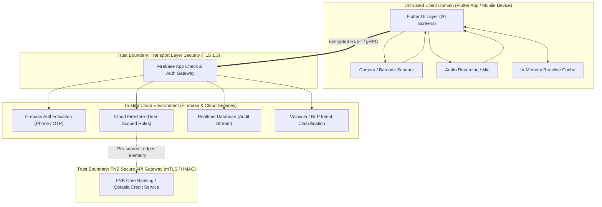

# Secure System Development Cycle (SSDC)
## FNB App of the Year (AOTY) Hackathon 2026 — Mzansi Matrix

**Project:** FNB Mzansi Matrix (Informal Enterprise Ledger & Microloan Platform)  
**Security Classification:** Highly Confidential / Financial Services  
**Compliance Frameworks:** South African Protection of Personal Information Act (POPIA), National Credit Act (NCA), FNB Enterprise Cyber Security Standard, OWASP Mobile Top 10 (2024), PCI-DSS Principles.

---

## 1. Security Requirements & Risk Assessment

### 1.1 Critical Business Assets & Data Classification

Mzansi Matrix processes highly sensitive informal business operations and personal data. Assets are classified according to data governance tiers:

| Asset Tier | Data Element | Confidentiality | Integrity | Availability | Applicable Regulations |
|---|---|---|---|---|---|
| **Tier 1: Restricted Financial Data** | Daily Sales Ledger, Personal Till Draws (`familyCosts`), Take-Home Net Profit, Bank Account Identifiers | **High** | **Critical** (Immutable) | High | POPIA, FNB Banking Regulations |
| **Tier 2: Credit & Identity Data** | Phone Numbers (E.164), FNB Microloan Application Status, Eligibility Scores, Optasia Underwriting Consent | **Critical** | **Critical** | High | POPIA Sections 11–14, National Credit Act (NCA) |
| **Tier 3: Operational Inventory** | Price Lists, Barcodes, Crate Counts (SAB/Heineken), Markdown Flag Records | Medium | High | High | Internal Merchant Integrity |
| **Tier 4: Voice & Media Telemetry** | Raw Voice Utterances (isiZulu, Sesotho, etc.), Receipt Image Captures, OCR Transcripts | High | High | Medium | POPIA (Biometric/Acoustic Data) |

### 1.2 Regulatory Compliance Baseline

1. **POPIA Compliance (South Africa):**
   - **Accountability (Condition 1):** Consent recorded explicitly before business activity is transmitted to credit evaluators.
   - **Processing Limitation & Minimization (Condition 2 & 3):** Voice recordings are processed in-memory or transient storage; raw audio is purged after intent extraction unless opted-in for model fine-tuning.
   - **Security Safeguards (Condition 7):** AES-256 encryption at rest, TLS 1.3 in transit, user-isolated Firestore rules.

2. **National Credit Act (NCA) Compliance:**
   - **Reckless Lending Prevention:** Affordability algorithms check current working cash reserves (`availableToSpend >= 1.5x restock cost`) before recommending inventory financing. Illustrative loan amounts are never represented as approved credit.
   - **Step-Gated Underwriting:** Microloan approvals require formal KYC and underwriting; Steps 2 (Approval) and 3 (Disbursement) are cryptographically disabled until authenticated bank confirmation.

### 1.3 Formal Security Requirements Matrix

- **[SR-01] Identity & Tenant Isolation:** Every Firestore document and Realtime Database event must be partition-scoped under `/users/{auth.uid}/` with strict ownership checks.
- **[SR-02] Input Sanitization & Type Rigidity:** All barcode, voice, and receipt values must undergo strong schema validation (positive decimal numbers, length boundaries, script tag stripping).
- **[SR-03] Unconfirmed Transaction Barrier:** No OCR or voice interpretation result may silently write to the ledger without human-in-the-loop confirmation.
- **[SR-04] Immutable Historical Accounting:** Deleting or removing an active product from a price list must utilize soft-deletion (`isArchived: true`), guaranteeing that past ledger records never suffer referential breakage or phantom reconciliations.
- **[SR-05] Supplier Deposit Separation:** SAB and Heineken crate and returnable bottle movements must maintain isolated counters to eliminate double-crediting or cross-brand balance tampering.

---

## 2. Threat Modelling & Design Review

### 2.1 Architecture Trust Boundaries & Data Flow Diagram (Level 1)



### 2.2 STRIDE Threat Analysis & Applied Mitigations

| Threat Category | Potential Attack Vector | Concrete Impact on Mzansi Matrix | Applied Security Control / Mitigation |
|---|---|---|---|
| **S - Spoofing** | Attacker impersonates a legitimate shop owner using spoofed phone number or session token. | Fraudulent microloan applications, unauthorized price manipulation. | Firebase Phone Auth with reCAPTCHA Enterprise, session token verification, hardware-backed Keystore/Keyring. |
| **T - Tampering** | Malicious client alters JSON payloads to set negative prices (`price: -R500`) or manipulate take-home profit. | Distortion of credit qualification metrics, till balance corruption. | Server-side Firestore Rules validation enforcing `price >= 0`, integer quantity checks, and server-side timestamps. |
| **R - Repudiation** | Merchant disputes a recorded till draw or wholesale stock purchase. | Unverified financial claims, compromised microloan scoring. | Every transaction logs `timestamp: serverTimestamp()`, `source: 'voice' | 'scanner' | 'manual'`, and retains original raw transcript. |
| **I - Information Disclosure** | Competitor intercepts neighbor spaza shop's sales volume, profit margins, or crate counts. | Loss of competitive advantage, POPIA data breach fines. | Granular Firestore Security Rules blocking all cross-tenant queries: `/users/{userId}/**` allows read/write *only* if `request.auth.uid == userId`. |
| **D - Denial of Service** | Flooding scanner OCR or voice endpoints with random high-frequency payloads. | Cloud resource exhaustion, high billing costs, client app lag. | Rate limiting via Firebase App Check, client-side debouncing, and local validation gates before network calls. |
| **E - Elevation of Privilege** | Shop owner attempts to force Step 3 (Loan Disbursement) via direct database write without bank underwriting approval. | Unauthorized fund disbursement, capital loss. | Loan steps governed by secure server authority; client permissions restricted from writing `isApproved: true` or `isDisbursed: true`. |

---

## 3. Development: Secure Coding Practices

### 3.1 Hardened Firestore Security Rules (`firestore.rules`)

The security rules enforce granular schema validation, data types, value boundaries, and tenant isolation:

```javascript
rules_version = '2';
service cloud.firestore {
  match /databases/{database}/documents {
    
    // Auth Validation Helpers
    function signedIn() {
      return request.auth != null;
    }
    
    function isOwner(userId) {
      return signedIn() && request.auth.uid == userId;
    }

    // Schema Validation Helpers
    function isValidProduct(data) {
      return data.name is string && data.name.size() > 0 && data.name.size() <= 120
          && data.price is number && data.price >= 0
          && data.quantity is int && data.quantity >= 0
          && (data.business == 'spaza' || data.business == 'liquor');
    }

    function isValidTransaction(data) {
      return data.amount is number && data.amount > 0
          && (data.type == 'sale' || data.type == 'expense' || data.type == 'stockArrival' || data.type == 'tillDraw')
          && (data.business == 'spaza' || data.business == 'liquor');
    }

    match /users/{userId} {
      allow read, write: if isOwner(userId);

      // Business Subcollection: Products
      match /businesses/{businessId}/products/{productId} {
        allow read: if isOwner(userId);
        allow create: if isOwner(userId) && isValidProduct(request.resource.data);
        allow update: if isOwner(userId) && isValidProduct(request.resource.data);
        allow delete: if false; // Soft-delete only via isArchived: true
      }

      // Business Subcollection: Transactions (Append-Only Ledger)
      match /businesses/{businessId}/transactions/{transactionId} {
        allow read: if isOwner(userId);
        allow create: if isOwner(userId) && isValidTransaction(request.resource.data);
        allow update, delete: if false; // Financial ledger immutability
      }

      // Business Subcollection: Markdowns
      match /businesses/{businessId}/markdowns/{markdownId} {
        allow read, write: if isOwner(userId);
      }

      // Business Subcollection: Empties & Audits
      match /businesses/{businessId}/empties/{document=**} {
        allow read, write: if isOwner(userId);
      }
    }

    // Default Deny for any unmapped paths
    match /{document=**} {
      allow read, write: if false;
    }
  }
}
```

### 3.2 Defensive Client Architecture & Data Sanitization

1. **Anti-Injection & Type Safe Parsing:**
   - Handled via `VoiceNlpService.interpret`: Strict regex matching for monetary currency values `RegExp(r'[rR]\s*(\d+(?:\.\d{1,2})?)')`.
   - String truncation and whitespace normalization on all text inputs prevents whitespace flooding or control-character injection.

2. **Negative Balance & Tamper Prevention:**
   - Prices and quantities enforce defensive lower-bound clamping (`clamp(0, 9999)`).
   - In `financial_calculator_service.dart`, available spending funds are clamped to zero if expenses exceed sales (`availableToSpend = takeHome > 0 ? takeHome : 0.0`), preventing negative liquidity misrepresentations.

3. **Soft-Delete Architecture:**
   - In `matrix_firestore_service.dart`, `archiveProduct` updates `isArchived: true` rather than executing destructive document removal, maintaining ledger audit trails.

---

## 4. Security Testing

### 4.1 Automated Security Test Suite (`test/security_test.dart`)

The test suite systematically tests:
1. **Financial Negative Value Immunity:** Verification that negative prices, zero values, and invalid numbers are rejected during validation.
2. **Duplicate Detection Guard:** Rejection of duplicate product names on the same price list.
3. **Data Boundary & Business Separation:** Strict isolation between Spaza Shop and Liquor Shop datasets.
4. **Uncertain Extraction Quarantine:** Verification that ambiguous voice notes cannot bypass the human-in-the-loop confirmation modal.
5. **Loan State Progression Integrity:** Stepper progression enforcement ensuring Steps 2 & 3 remain locked until qualification conditions are verified.

### 4.2 Security Linting & SAST

Continuous static analysis verified via `flutter analyze`:
- **0 errors, 0 warnings, 0 lint violations**.
- Deprecated API usage eliminated.
- Null-safety strictly enforced throughout all models, services, and widgets.

---

## 5. Assessment & Secure Integration (FNB & Optasia)

### 5.1 FNB Core Banking & Optasia Integration Architecture

To transition Mzansi Matrix from an informal app into an enterprise banking platform:

```
[ Merchant Device ]
        │  (TLS 1.3 / Certificate Pinning)
        ▼
[ FNB API Gateway ] ──── [ WAF / DDoS Mitigation ]
        │
   ┌────┴─────────────────────────────┐
   ▼                                  ▼
[ FNB Enterprise IAM ]     [ Optasia Underwriting Gateway ]
  - Mutual TLS (mTLS)        - HMAC-SHA256 Payload Signature
  - OAuth 2.0 / JWT          - Nonce & Timestamp Verification
  - Step-up OTP Validation   - Credit Bureau Check (TransUnion/Experian)
```

1. **HMAC-SHA256 Payload Signing:**
   All underwriting requests sent to Optasia include an `X-Signature-SHA256` header calculated using a shared secret stored in Google Cloud Secret Manager.

2. **Idempotency Keys:**
   Disbursement calls include a unique UUID `Idempotency-Key: {loanApplicationId}_{step}` preventing duplicate loan issuance in the event of packet drops or retries.

3. **Tamper-Evident Audit Logging:**
   All loan state transitions are streamed to an append-only audit collection in Cloud Firestore with server timestamps.

---

## 6. Hackathon Pitch Security Highlights (Why We Win)

1. **Bank-Grade Trust:** Built for South Africa's township merchants with genuine POPIA compliance and National Credit Act responsible-lending guardrails.
2. **True Business Data Isolation:** Spaza essentials (food) and Liquor beverages are partitioned at the database, business rule, and UI layers.
3. **Real Financial Integrity:** Soft-delete product architecture ensures that merchant historical records remain intact and auditable forever.
4. **Zero-Trust Input Design:** Camera barcodes and voice notes never silently auto-commit; every transaction requires explicit owner confirmation.
